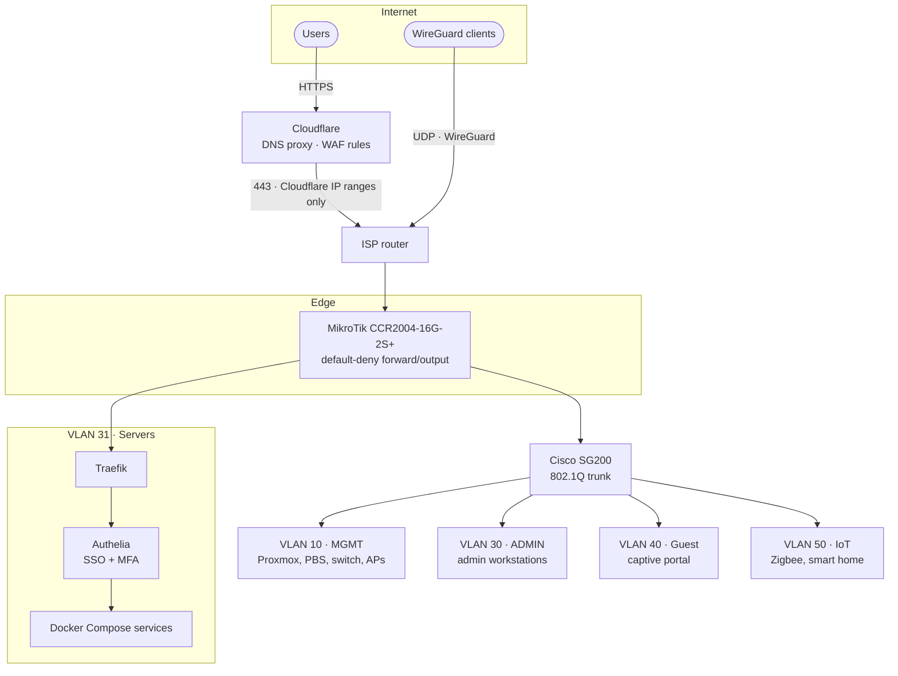

# Home Lab

Production-style home lab I use to design, test and document network and infrastructure setups end to end: segmentation, secure remote access, reverse proxying with SSO, monitoring and documentation as code.

> **Note:** IP addressing, hostnames and domains in this repo are illustrative. Real values, credentials and keys live in a private repository and are never committed here.

## Architecture



## Network segmentation

| VLAN | Name | Subnet (illustrative) | Purpose | Internet |
|---|---|---|---|---|
| 10 | MGMT | `10.0.10.0/24` | Hypervisors, backup server, switch, APs | Allow-list only |
| 30 | ADMIN | `10.0.30.0/24` | Admin workstations | Yes |
| 31 | SERVERS | `10.0.31.0/24` | VMs and containers (Traefik, apps, monitoring) | Yes |
| 32 | ISOLATED | `10.0.32.0/24` | Devices with no Internet access | No |
| 40 | GUEST | `10.0.40.0/24` | Guest Wi-Fi with captive portal | Yes, isolated |
| 50 | IOT | `10.0.50.0/24` | Smart home, Zigbee coordinator, voice assistants | Yes |
| — | WireGuard | `10.0.100.0/24` | Remote administration | Via lab |

Addressing convention: third octet = VLAN ID, `.1` = MikroTik gateway on every VLAN.

## Security model

1. **Default deny.** Forward and output chains on the MikroTik end in an explicit drop; every inter-VLAN flow is an allow rule based on address lists (e.g. ADMIN → MGMT, SERVERS ↔ IOT for Home Assistant).
2. **Two ways in, nothing else:**
   - **Administration:** WireGuard VPN only. Management interfaces are never published.
   - **Published services:** Cloudflare proxy → MikroTik accepts HTTPS **only from Cloudflare IP ranges** → Traefik → Authelia (SSO + MFA). Hitting the public IP directly does not reach any service.
3. **Cloudflare WAF** blocks critical internal apps (documentation, wiki…) from the Internet even though they share the reverse proxy.
4. **Restricted router egress:** DNS only to approved resolvers, NTP, updates and WireGuard.
5. **Secrets** are kept out of git: `.env.example` templates here, real values in a private repo. Every commit is scanned with [gitleaks](https://github.com/gitleaks/gitleaks).

## Hardware

| Device | Role |
|---|---|
| MikroTik CCR2004-16G-2S+ | Router, firewall, WireGuard, DHCP, guest hotspot |
| Cisco SG200 | Managed switch, VLAN trunking |
| Proxmox VE host 1 · Intel N305, 32 GB, 8× 2.5 GbE | Main hypervisor: Docker VM, UniFi controller, monitoring LXC |
| Proxmox VE host 2 · i5-6500, 48 GB | Proxmox Backup Server VM on a mirrored SSD datastore |
| QNAP TS-435XeU | NAS: RAID1 HDD (data) + RAID1 NVMe; dedicated 2.5 GbE storage link to the main hypervisor (/29) |
| UniFi U6 Pro + U6+ | Wi-Fi, one SSID per VLAN, PoE from the switch |
| SMLIGHT SLZB-06 | Ethernet/PoE Zigbee coordinator for Home Assistant |
| Legrand KEOR 800 VA UPS + Raspberry Pi (NUT) | Power telemetry and graceful shutdown |
| 24-port Cat6 patch panel | Structured cabling, documented port by port |

## Monitoring

- **Zabbix 7 + Grafana** (LXC): SNMP polling of the MikroTik and Cisco SG200, Zabbix agent 2 on the Proxmox hosts, UniFi APs, Home Assistant and the UPS via NUT.
- **Prometheus + cAdvisor + node-exporter** for container and host metrics on the Docker VM.
- **Speedtest Tracker** for WAN performance history.

## Containers

The Docker VM runs ~25 Compose stacks ([`services/`](services/)). Containers get their own address on VLAN 31 through an **ipvlan** network (and Home Assistant also on VLAN 50 for local IoT discovery), so the MikroTik firewall sees and filters each service individually. Databases sit on internal bridge networks, and credentials are passed as **Docker secrets** from files outside the repo.

Highlights: Traefik, Authelia, AdGuard Home, Home Assistant, Zigbee2MQTT, Mosquitto, Nextcloud, Immich, Paperless-ngx, Prometheus.

## Documentation as code

The full inventory (hardware, services, systems, ports) lives in [`rackpeek/config.yaml`](rackpeek/config.yaml) and is published as a **read-only [RackPeek](https://github.com/Timmoth/RackPeek) viewer on GitHub Pages** by [this workflow](.github/workflows/rackpeek-pages.yml). It is a static WebAssembly site: it never connects to the lab, and the real RackPeek instance stays internal.

## Repository layout

```
.
├── docs/                 # Design notes and diagrams
├── services/             # Docker Compose stacks (secrets referenced, never included)
├── network/              # Sanitized MikroTik / switch configuration
├── rackpeek/config.yaml  # Inventory (documentation as code)
└── .github/workflows/    # Secret scanning + RackPeek Pages deploy
```
